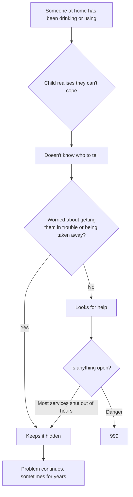
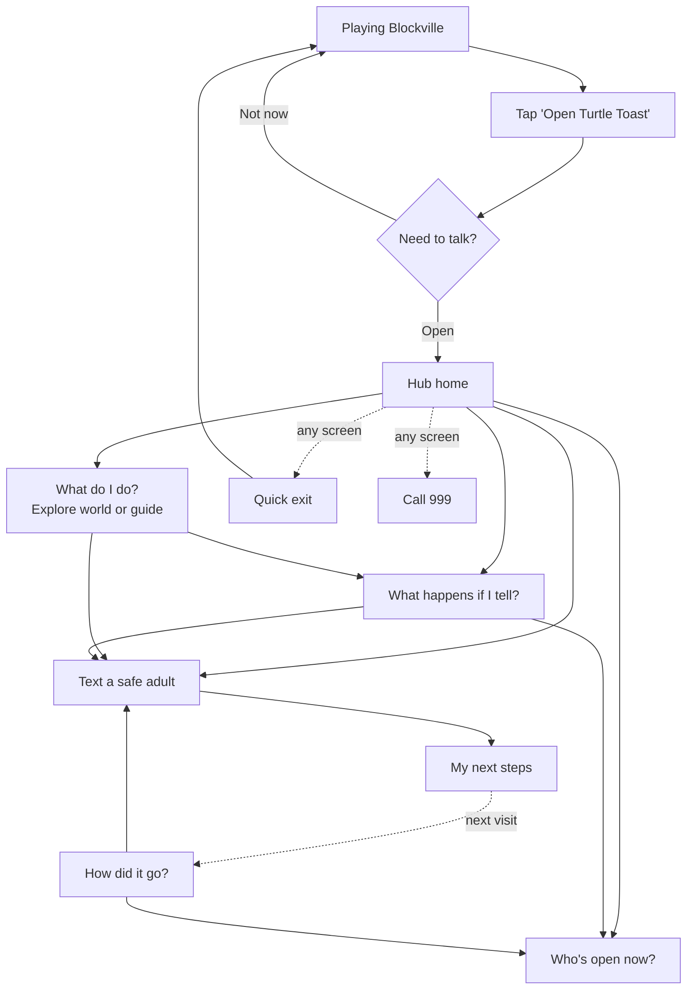
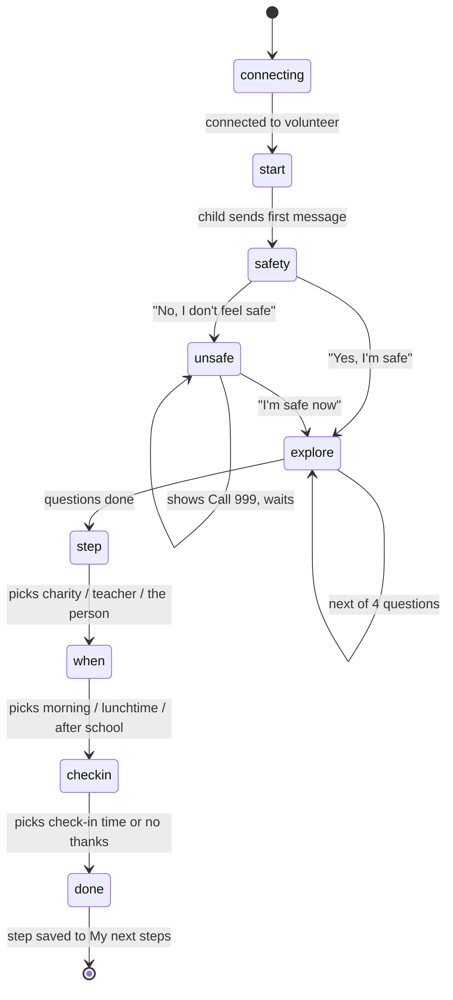
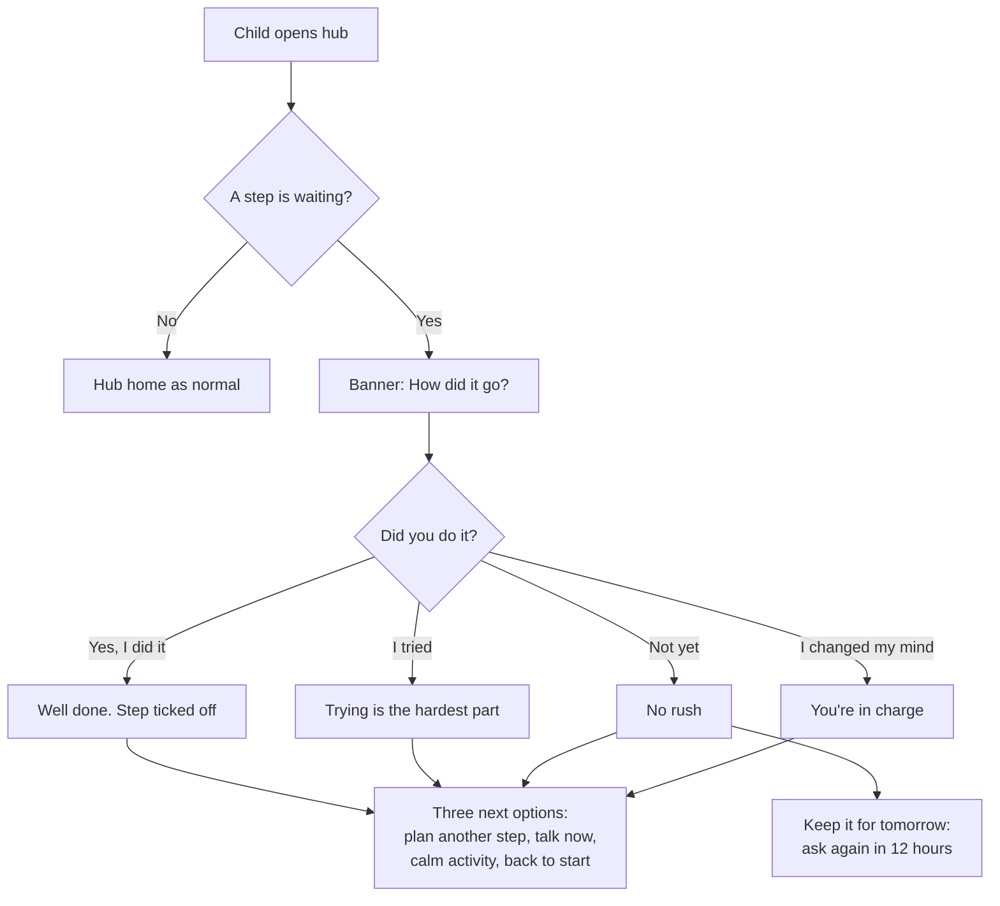
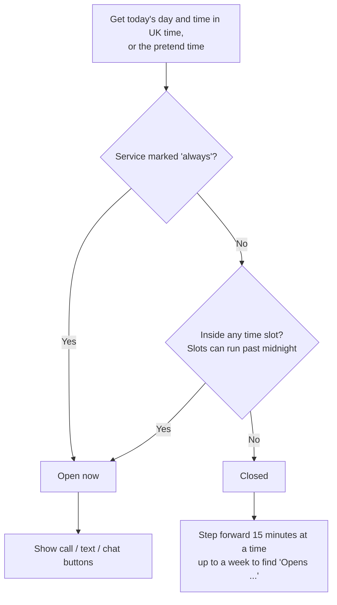
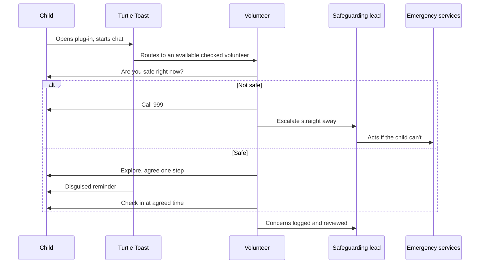

# Process flows

Diagrams are in Mermaid, which GitHub draws automatically.

## 1. As is: a child at 9pm on a school night (from the Ellie persona)

Pain points: fear of the consequences of telling, not knowing what's open, nothing that speaks to a child in their own words, and no private way in.

## 2. To be: overall journey through Turtle Toast

## 3. Text a safe adult: the chat stages

Each box is a stage in `src/screens/safe-adult.js`.

At any stage after "start", typing free text gets a listening reply and the chat stays on the same stage.

## 4. How did it go?: following up a step

## 5. Who's open now: deciding open or closed

## 6. Swimlane: what a real service would add (to be validated)

How the prototype's chat might work with real people behind it. A starting point for discussion, not a design.

